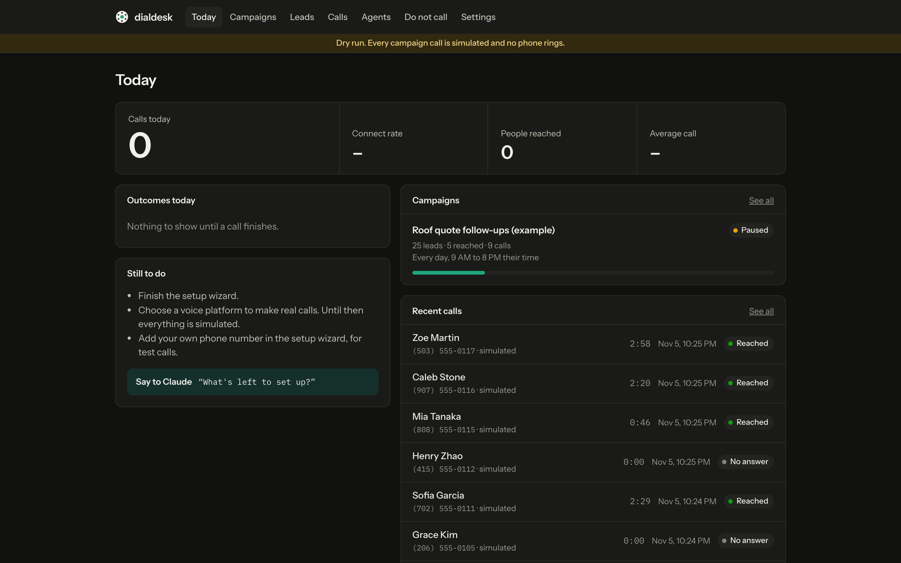
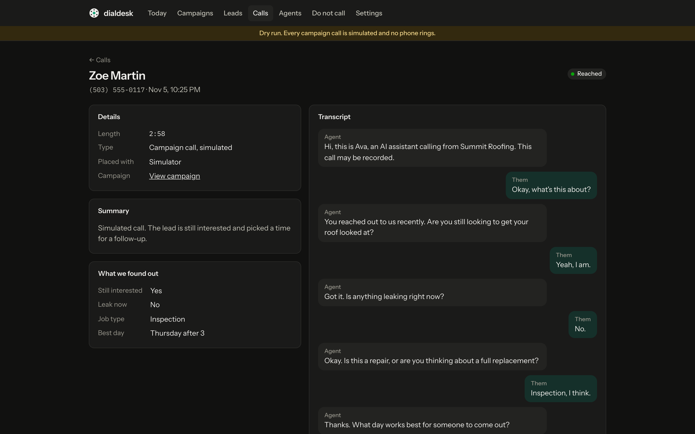

# dialdesk

A calling desk that runs on your computer. Your leads go in, an AI voice agent calls them on a schedule, and you watch it happen. Claude Code sets it up and runs it for you.

Paste this into Claude Code:

```
Clone https://github.com/SlaviSavanovic/dialdesk into a new folder, then follow ONBOARDING.md inside it.
```

Claude installs it and opens a setup wizard for your platform key and a few questions about your calls. Then it writes your script, runs a practice campaign, and rings your own phone so you can hear the agent. No real calls go out until you turn on live calling yourself.





## What you need

- [Claude Code](https://claude.com/claude-code)
- [Node.js](https://nodejs.org) 22.18 or newer (Claude can help you install it)
- An account with a voice platform, when you want real calls. Until then everything is simulated, so you can try the whole thing with no accounts.

| Platform | Good to know |
|---|---|
| **Bland AI** | The easiest start. It can dial from its own US numbers, so you don't need to buy one. |
| **Vapi** | Needs a Twilio number, because free Vapi numbers can only take calls. |
| **Retell AI** | You can buy a number directly from Retell. |
| **ElevenLabs** | Needs a Twilio or SIP number connected. |
| **Synthflow** | Create your agent in their dashboard, then dialdesk calls with it. |

Using something else? Tell Claude "add support for [platform]". A new platform is one file, and Claude can write it from the platform's docs.

## What it does

- **Leads:** bring in any CSV. Claude sorts out the columns and phone number formats.
- **Campaigns:** who to call, what days and hours, how fast, and how many tries.
- **Scripts:** Claude writes them with you, most important question first.
- **Call log:** transcripts, summaries, and what each call found out.
- **Do-not-call list:** anyone who says stop is added right after the call, and no campaign can reach them again.

There are no forms for any of this. You say what you want and Claude does it, while the dashboard updates next to the chat.

## Where your keys go

Into the setup wizard, in your browser. They're saved in a `.env` file on your computer, which git ignores and Claude is blocked from reading. **Never paste a key into the chat.**

## Permission to call is your responsibility

**dialdesk is software, not legal advice, and the people who use it are responsible for how they use it.** It's provided as is, with no warranty, under the MIT license.

**dialdesk doesn't check whether you have permission to call anyone.** You can keep a consent source and date on each lead for your own records, but they don't affect dialing. Getting permission and following the rules is up to you.

Some things worth knowing, as a starting point and not a complete list:

- In the US, the FCC treats AI-generated voices as artificial voices under the Telephone Consumer Protection Act. Those calls generally need the person's prior express consent, and telemarketing calls need it in writing.
- dialdesk doesn't check national do-not-call registries or do any state registration for you.
- Rules on calling hours, the number of attempts, and recording calls vary by state and country. Some are stricter than the defaults here.

If you're unsure what applies to you, ask a lawyer.

### What the app does on its own

| | |
|---|---|
| **Dry run** | On by default. Every campaign call is simulated until you turn on live calling. |
| **AI disclosure** | Every call opens by saying it's an AI. The app won't dial without it. |
| **Calling hours** | 9 AM to 8 PM in the lead's local time by default, and it can't go outside 8 AM to 9 PM. If it can't tell where a lead is, it doesn't call them. |
| **Do-not-call** | Opt-outs and imported numbers are never dialed again. |
| **Attempts** | A limit per lead, with a minimum gap between tries. |
| **Test calls** | Can only ring the one number you entered as your own. |

These are guardrails, not guarantees. It's open source and runs on your computer, so you can change them, and you're responsible if you do.

## Running it yourself

```bash
npm install
```

```bash
npm start
```

Then open http://localhost:3000. If that port is taken, it uses the next free one and prints the address.

```bash
npm test
```

## Good to know

- **Your computer has to be on.** Calls only go out while the app is running. Windows that get missed are skipped, and it won't try to catch up in a burst.
- **Platforms bill you directly** for every minute, and dialdesk has no spending limit of its own.
- **The real platform connections were built from each platform's docs.** See [MAP.md](MAP.md) for which ones have been tried on live calls.

## License

MIT. See [LICENSE](LICENSE).
